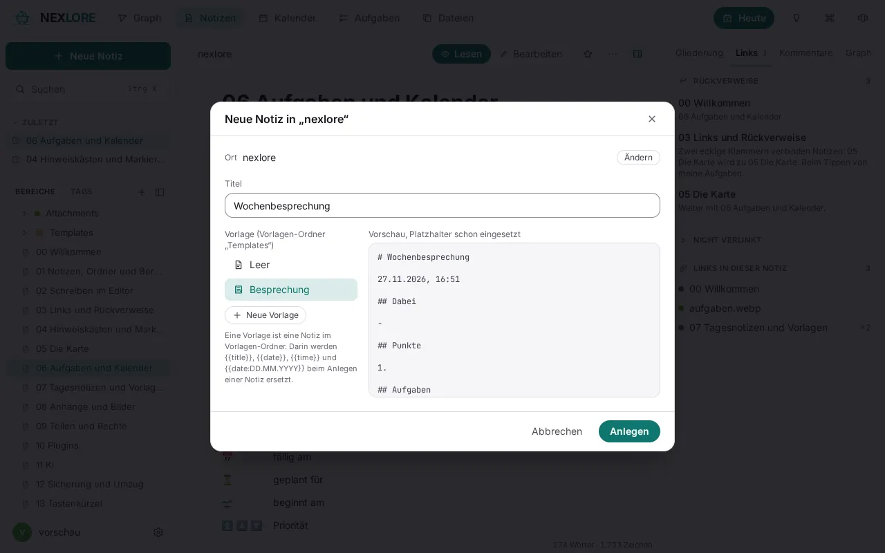

# Anhänge und Bilder

Zurück zu [[00 Willkommen|Willkommen]].

Bilder und Dateien ziehst du in den Editor, fügst sie mit `Strg+V` ein oder wählst sie über die Büroklammer in der Werkzeugleiste. nexlore legt sie im Ordner „Attachments“ neben der Notiz ab und verlinkt sie mit einem normalen Markdown-Link, so wie das Bild hier:

## Was nexlore mit Dateien tut

- **Ort und Gerät** entfernt nexlore beim Hochladen aus Fotos und Videos (der Betreiber kann das abschalten).
- **HEIC-Fotos** vom iPhone bekommen eine WebP-Fassung, die jeder Browser zeigt.
- **Doppelte** erkennt nexlore am Inhalt und verlinkt die vorhandene Datei.
- **PDFs** werden durchsucht: Die Suche findet auch Text darin.
- Verschiebst du eine Notiz, wandern ihre Anhänge mit.
- Hat eine Notiz einen eigenen Ordner im Anhang-Ordner (ein Namensmuster wie `{note}/{filename}` legt ihn an), bietet das Umbenennen an, ihn gleich mit umzubenennen; die Links ziehen mit.

Die Seite **Dateien** zeigt alle Anhänge eines Bereichs, auch die, die keine Notiz mehr benutzt.

## Zeichnen

Hier steht eine Zeichnung. Fahr mit der Maus darüber und klick auf **Zeichnen**, dann zeichne mit Stift, Maus oder Finger hinein.

![[Skizze.svg]]

Eine neue Zeichnung legst du im Editor über **Zeichnung** in der Werkzeugleiste an oder mit `/` und „Zeichnung“. Sie entsteht dort, wo der Cursor steht, und ist gleich zum Zeichnen offen.

- **Werkzeuge:** Stift, Textmarker, Radierer und Auswählen, dazu Farben und Stärken. Die Farbe „Tinte“ folgt hell und dunkel. Ein zweiter Klick auf den Radierer wählt, ob er ganze Striche nimmt oder nur, was du überfährst. Mit Auswählen umfährst du Striche und verschiebst oder löschst sie.
- **Papier:** leer, liniert, kariert oder Punkte.
- **Fläche ohne Rand:** Leertaste oder rechte Maustaste gedrückt ziehen verschiebt, `Strg` und Mausrad zoomt, `Shift+1` zeigt alles. Ein Finger verschiebt, Stift und Maus zeichnen.
- **Tasten:** `P` Stift, `M` Textmarker, `E` Radierer, `L` Auswählen, `Entf` löscht die Auswahl.
- **Speichern** geschieht von selbst. `Strg+Z` nimmt zurück. **Fertig** oder `Esc` beendet das Zeichnen und merkt sich den Ausschnitt, den die Notiz zeigt; die Höhe in der Notiz ziehst du am unteren Rand.
- **Groß öffnen** gibt der Zeichnung das ganze Fenster. Rechts steht, welche Notizen sie nutzen; **Zurück** oder `Esc` führt dorthin, woher du kamst.

Jede Zeichnung ist eine SVG-Datei im Anhang-Ordner der Notiz. In Obsidian und jedem Bildbetrachter ist sie ein ganz normales Bild.

## PDFs lesen

Ein Klick auf ein PDF öffnet es in nexlore, nicht als Download. Links stehen Bilder der Seiten und das Inhaltsverzeichnis des PDFs, oben blätterst du, zoomst und suchst im Text (`Strg+F`). Das Kettenglied kopiert einen Link auf die Seite, die du gerade siehst, etwa `[[Handbuch.pdf#page=3]]`: Ein Klick darauf öffnet das PDF genau dort.

`![[Handbuch.pdf#page=3]]` zeigt das PDF in der Notiz, zum Blättern, `#height=400` setzt die Höhe. Rechts neben dem PDF steht, welche Notizen darauf verlinken und auf welche Seiten. **Notiz zu diesem PDF** legt daneben eine Notiz an und öffnet sie neben dem PDF, damit du beim Lesen schreibst.

## Drucken und als PDF speichern

Im Menü **⋯** einer Notiz stehen **Drucken …** und **Als PDF speichern …**. Das Fenster zeigt die Seiten so, wie sie auf Papier kommen, und jede Wahl rechts gleich mit: Papier, Eigenschaften, eingebettete Notizen, Links als Fußnote, Kopf und Fuß, Schrift. Gedruckt wird immer hell.

Einen ganzen Ordner speicherst du über das Menü des Ordners in der Seitenleiste als ein PDF, mit Deckblatt und Inhaltsverzeichnis. Links zwischen Notizen im selben PDF lassen sich darin anklicken.

Weiter mit [[09 Teilen und Rechte]].
