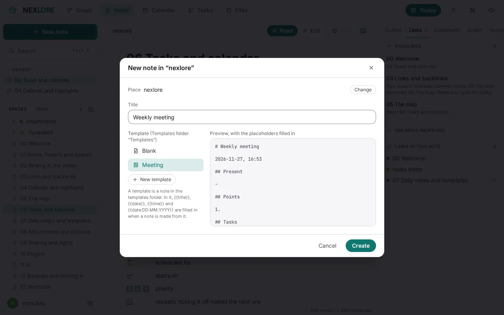

# Attachments and pictures

Back to [[00 Welcome|Welcome]].

Drag pictures and files into the editor, paste them with `Ctrl+V`, or pick them with the paper clip in the toolbar. nexlore puts them into the "Attachments" folder beside the note and links them with an ordinary Markdown link, like the picture here:

## What nexlore does with files

- **Place and device** are taken out of photos and videos on upload (the operator can switch that off).
- **HEIC photos** from an iPhone get a WebP copy that every browser shows.
- **Duplicates** are recognised by their content; the file already there is linked instead.
- **PDFs** are searched: the search finds text inside them too.
- When a note moves, its attachments go with it.
- When a note has a folder of its own in the attachment folder (a name pattern like `{note}/{filename}` makes one), renaming the note offers to rename that folder too; the links follow.

The **Files** page lists every attachment of a space, those no note uses any more too.

## Drawing

Here is a drawing. Move the mouse over it and click **Draw**, then draw into it with a pen, the mouse or a finger.

![[Sketch.svg]]

You make a new drawing in the editor with **Drawing** in the toolbar, or with `/` and “Drawing”. It appears where the cursor is and is open for drawing at once.

- **Tools:** Pen, Highlighter, Eraser and Choose, with colours and sizes. The colour “Ink” follows light and dark. Clicking the eraser a second time chooses whether it takes whole strokes or only what you go over. With Choose you draw around strokes and move or delete them.
- **Paper:** plain, lined, squared or dotted.
- **A surface without end:** dragging with Space or the right mouse button held moves it, `Ctrl` and the mouse wheel zoom, `Shift+1` shows everything. A finger moves, a pen and the mouse draw.
- **Keys:** `P` pen, `M` highlighter, `E` eraser, `L` choose, `Delete` removes what is chosen.
- **Saving** happens by itself. `Ctrl+Z` takes a step back. **Done** or `Esc` ends drawing and keeps the part the note shows; drag the lower edge for its height in the note.
- **Open large** gives the drawing the whole window. On the right stand the notes that use it; **Back** or `Esc` takes you where you came from.

Every drawing is an SVG file in the note's attachment folder. In Obsidian and any picture viewer it is an ordinary picture.

## Reading PDFs

A click on a PDF opens it in nexlore instead of downloading it. On the left are pictures of the pages and the PDF's own contents; at the top you turn pages, zoom and find text (`Ctrl+F`). The chain link copies a link to the page you are looking at, such as `[[Manual.pdf#page=3]]`: a click on it opens the PDF right there.

`![[Manual.pdf#page=3]]` shows the PDF inside the note, to page through, and `#height=400` sets its height. Next to the PDF you see which notes link it, and to which pages. **Note on this PDF** makes a note next to it and opens it beside the PDF, so you write while you read.

## Printing and saving as PDF

The **⋯** menu of a note has **Print …** and **Save as PDF …**. The window shows the pages as they come on paper, and every choice on the right at once: paper, properties, embedded notes, links as footnotes, header and footer, font. Paper is always light.

A whole folder becomes one PDF through the folder's menu in the sidebar, with a cover and contents. Links between notes in the same PDF can be clicked in it.

Next: [[09 Sharing and rights]].
